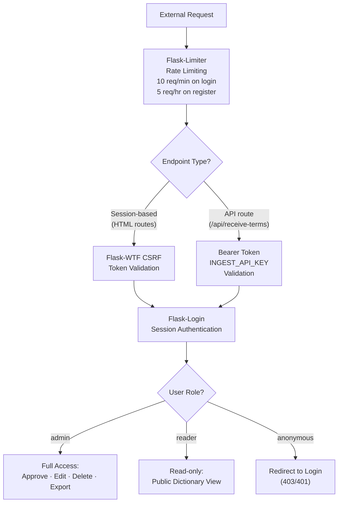

<div align="center">

# ⚖️ AI Legal Termbase Ecosystem
### *An Integrated Human-in-the-Loop System for Legal Terminology Extraction, Alignment, and Management*

---

**Developed by:** Youssef Nour Eldin Al-Maqamaz  
**Academic Context:** Department of Translation Studies — Graduation Project Presentation  
**System Version:** 3.0 (Production-Ready Ecosystem)

[](https://github.com/yousefdg005/qwqw)
[](https://github.com/yousefdg005/-)
[](https://github.com/yousefdg005)
[](https://github.com/yousefdg005)

</div>

---

## 📋 Table of Contents

1. [Overview](#1-overview)
2. [System Architecture — The Two-Platform Ecosystem](#2-system-architecture--the-two-platform-ecosystem)
3. [Core Philosophy: Human-in-the-Loop (HITL)](#3-core-philosophy-human-in-the-loop-hitl)
4. [Under the Hood: Prompt Engineering Strategy](#4-under-the-hood-prompt-engineering-strategy)
5. [Innovative Core Functions Deep Dive](#5-innovative-core-functions-deep-dive)
6. [Getting Started & Full Workflow](#6-getting-started--full-workflow)
7. [Technology Stack](#7-technology-stack)
8. [Data Models & Export Formats](#8-data-models--export-formats)
9. [Security Architecture](#9-security-architecture)
10. [Academic Contribution](#10-academic-contribution)

---

## 1. Overview

This project is a **bilingual (English ↔ Arabic) legal termbase construction system** that merges the analytical power of large language models (LLMs) with the irreplaceable domain expertise of the human translator. It was designed, engineered, and deployed as an academic capstone project demonstrating a production-grade approach to computer-assisted terminology management.

The ecosystem comprises **two independent but deeply integrated platforms** that form a complete pipeline from raw parallel legal documents to a curated, export-ready, standards-compliant termbase:

| Platform | Repository | Role in the Pipeline |
|----------|------------|----------------------|
| **AI Legal Workspace** (`qwqw`) | [yousefdg005/qwqw](https://github.com/yousefdg005/qwqw) | Sentence alignment studio + AI-powered term extraction engine |
| **Legal Dictionary** (`-`) | [yousefdg005/-](https://github.com/yousefdg005/-) | Termbase management, human review workflow, and multi-format export |

### Academic Objective

> To demonstrate that AI models, when governed by rigorous prompt engineering and enforced human oversight, can serve as a reliable *pre-processing assistant* in professional translation workflows — without replacing the translator's judgment, but dramatically reducing their cognitive load in terminology mining.

The system targets **legal texts** specifically (contracts, legislation, international law, commercial and civil law) — the most terminology-dense genre in professional translation — and enforces standards compatible with industry-leading CAT tools such as **SDL Trados**, **memoQ**, and **Phrase TMS**.

---

## 2. System Architecture — The Two-Platform Ecosystem

```mermaid
flowchart TD
    A["📄 Source Documents\n(.docx — EN + AR parallel files)"] --> B

    subgraph P1["⚡ Platform A — AI Legal Workspace (Streamlit / qwqw)"]
        B["extract_text_from_docx_bytes()\nText Extraction & Unicode Normalization"]
        B --> C["process_docx_text_to_segments()\nSmart Sentence Segmentation\n(Abbreviation-aware)"]
        C --> D["align_segments()\nDP-based Bilingual Alignment\n(1:1, 1:2, 2:1 merging)"]
        D --> E["🎛️ Alignment Studio (Custom HTML5 Component)\nHuman Interactive Review:\nDrag-and-Drop · Split · Edit · Undo"]
        E --> F["👤 HUMAN APPROVAL\n'Adopt Final Alignment'\nButton Required"]
        F --> G["generate_tmx_file()\nTMX 1.4 Export\n(CAT-compatible memory)"]
        G --> H["AI Term Extraction Engine\nsystem_prompt → LLM via OpenRouter API\nTemperature = 0.0 · JSON Mode"]
        H --> I["_is_low_value_term() Filter\nPost-AI Programmatic Deduplication\nvia _term_key() Normalization"]
        I --> J["📊 Editable Results Table\n(st.data_editor — Human Final Edit)"]
        J --> K["👤 HUMAN APPROVAL\n'Send to Dictionary'\nButton Required"]
        K --> L["send_to_dictionary()\nBatched API POST\nwith Bearer Token Auth"]
    end

    subgraph P2["🏛️ Platform B — Legal Dictionary (Flask / '-')"]
        L --> M["receive_terms() API\nIdempotent Deduplication\nstatus = 'pending'"]
        M --> N["📋 Admin Dashboard\nHuman Termbase Editor"]
        N --> O{"👤 ADMINISTRATOR\nTerm-by-Term Decision"}
        O -- "✅ Approve" --> P["status = 'approved'\nPublished to Dictionary"]
        O -- "🗑️ Reject/Delete" --> Q["Term Discarded"]
        P --> R["Multi-Format Export\nCSV · Excel · TBX (ISO 30042) · TMX"]
    end

    R --> S["🔧 CAT Tools Integration\nSDL Trados · memoQ · Phrase TMS"]

    style F fill:#EAB308,color:#000,font-weight:bold
    style K fill:#EAB308,color:#000,font-weight:bold
    style O fill:#EAB308,color:#000,font-weight:bold
    style P1 fill:#0D1424,color:#EEF2F8
    style P2 fill:#1E293B,color:#EEF2F8
```



> [!IMPORTANT]
> The three **golden HUMAN APPROVAL nodes** (highlighted in amber) are hard-coded gates — no data crosses a pipeline boundary without an explicit human action. This is the architectural embodiment of the Human-in-the-Loop principle.

---

## 3. Core Philosophy: Human-in-the-Loop (HITL)

### 3.1 The Problem This Solves

Fully automated term extraction from AI models suffers from two compounding failure modes in legal translation:

1. **Hallucination Risk**: The model may extract a term that *looks* legal but whose Arabic equivalent is incorrect, archaic, or inconsistent with the jurisdiction-specific usage in the source document.
2. **Context Blindness**: A model processing a single segment cannot know that "consideration" in one contract is a legal term (عوض) while in another document it is a philosophical concept (اعتبار).

The HITL architecture in this system addresses both failure modes through **three enforced human checkpoints**.

### 3.2 The Three Human Gates

#### Gate 1 — Alignment Review (Alignment Studio)

After the automatic DP-based sentence alignment, the translator is presented with an interactive studio — not a static preview. The translator can:

- **Drag individual segments** (English-only or Arabic-only) to swap their pairings
- **Split a segment** at cursor position when the AI has merged two distinct clauses
- **Delete erroneous pairs** with a single click
- **Undo** any action (up to 50-step history stack)
- **Directly edit** the content of any cell inline

**The critical design decision:** The "Generate TMX" button is entirely disabled unless the translator clicks **"Adopt Final Alignment"**. The raw algorithmic output is therefore *never* saved — only the human-validated version.

```python
# Platform A — app.py (qwqw), Lines 579–588
if st.button("🚀 اعتماد المحاذاة النهائية وتوليد TMX", use_container_width=True):
    current_pairs = st.session_state.get("alignment_draft", current_pairs)
    final_pairs = [
        (p["en"].strip(), p["ar"].strip()) for p in current_pairs
        if p["en"].strip() and p["ar"].strip()  # Only valid, non-empty pairs pass
    ]
    if final_pairs:
        st.session_state["aligned_pairs"] = final_pairs
        st.session_state["tmx_bytes"] = generate_tmx_file(final_pairs)
```

#### Gate 2 — Term List Review (Editable Table)

After AI extraction, the system presents every extracted term in a **live-editable `st.data_editor` table**. The translator can:

- Correct any mistranslated Arabic equivalent directly in the cell
- Delete spurious terms that slipped through the AI filters
- Modify definitions or subject-field labels
- Add new rows manually discovered during review

Only after reviewing this table does the translator click **"Send to Dictionary"** — triggering the API push.

#### Gate 3 — Administrator Termbase Approval (Legal Dictionary)

Every term arriving at the Legal Dictionary platform receives `status='pending'` by default. The administrator (a senior translator or editor) must individually or in bulk:

- **Review** the term alongside its definition and source text context (the exact sentence it was extracted from is stored and displayed)
- **Approve** → term moves to `status='approved'` and becomes publicly visible
- **Reject/Delete** → term is permanently discarded

This three-gate architecture ensures that **no AI-generated term can enter the production termbase without explicit human validation at every stage of the pipeline**.

### 3.3 The Translator as Maestro

The system is intentionally designed so the AI performs the *laborious* tasks (scanning thousands of segments, applying six-condition terminological tests simultaneously, generating structured output) while the human translator remains the **sole authority** over:

| Decision | Human or AI? |
|---|---|
| Which sentence pairs the alignment algorithm produces | **AI Draft → Human Final** |
| Whether a candidate is terminologically valid | **AI Proposes → Human Confirms** |
| Whether the Arabic equivalent is contextually appropriate | **Human Only** |
| Whether a term enters the official termbase | **Human Only (Admin)** |
| Corrections to AI-generated definitions | **Human Only** |

---

## 4. Under the Hood: Prompt Engineering Strategy

The extraction system prompt (`system_prompt`, ~110 lines) is the most technically sophisticated component of this project. This section dissects its engineering decisions.

### 4.1 Persona Definition — Anchoring Model Behavior

The prompt opens with an explicit **role definition** designed to activate the model's legal-domain reasoning mode and suppress generalist tendencies:

```
You are a senior legal terminologist and termbase editor working on
English–Arabic legal texts (contracts, legislation, international law,
commercial and civil law). You produce entries of the kind found in a
professional bilingual legal termbase.
```

This is not decorative prose. Research in prompt engineering confirms that persona anchoring reduces out-of-domain outputs by biasing the model's next-token probability distribution toward specialised vocabulary. The specific mention of **"termbase editor"** (as opposed to "translator" or "linguist") further constrains the model to think in discrete, structured *entries* rather than free-form prose.

### 4.2 The Six-Condition Terminological Gate — A Formal Test Battery

Rather than asking the model to "find legal terms," the prompt implements a **six-condition logical AND gate** that every candidate must pass:

```
A candidate must pass ALL six tests:
1. Concept test    — designates a legal concept (right, duty, doctrine...)
2. Definability test — can be defined by genus + differentia
3. Form test       — EN: noun/noun phrase 1–6 words; AR: 1–6 words, noun or idafa
4. Independence test — keeps full legal meaning outside its source sentence
5. Specialisation test — exclusive to law OR carries a specialised legal meaning
6. Alignment test  — both EN and AR equivalents actually appear in the supplied text
```

This battery mirrors the **terminological theory** (Wüster, Cabré, Felber) used in academic translation programs — specifically the definitional criteria for a "term" vs. a "word." Encoding this as a prompt instruction forces the model to apply theoretically grounded filtering, not heuristic pattern-matching.

### 4.3 Negative Constraints — Hallucination Prevention Architecture

The most innovative prompt engineering feature is the **AUTOMATIC REJECTIONS** block, which enumerates 10 categories of candidates that must be rejected regardless of how term-like they appear:

```
Reject any candidate that:
- contains a finite verb or modal (shall, may, must, يجب, يلتزم...)
  → Prevents clause extraction masquerading as terms

- is a boilerplate formula (pursuant to, in accordance with, بناءً على...)
  → Prevents legal boilerplate from polluting the termbase

- is a date, number, amount, percentage, duration, or article reference
  → Prevents numeric noise contamination

- is a document-specific label ("First Party", "the Contractor", "the Premises")
  → Prevents extracting party names as generic terms

- starts or ends with a preposition, conjunction, article, or punctuation
  → Prevents fragment extraction from alignment boundaries

- exceeds 6 words in either language
  → Prevents clause-length strings from entering as "terms"
```

Each constraint is a **specific anti-hallucination measure** targeting a known failure mode of LLMs in legal term extraction. The model is not asked to "be careful" — it is given an explicit, enumerable checklist of what constitutes failure.

### 4.4 Structured Output Enforcement — Zero-Ambiguity JSON Schema

The prompt enforces a **precise JSON schema** with multiple reinforcing instructions:

```
OUTPUT FORMAT
Return STRICTLY valid JSON and nothing else:
no markdown, no code fences, no comments, no text before or after.

{"terms": [{"ID": 1, "en": "...", "ar": "...",
            "definition": "...", "subject field": "..."}]}

ID is an integer starting at 1 and increasing by 1.
Keep every string on one line, escape internal quotation marks,
and leave no trailing commas.
```

Furthermore, the API call enforces this at the **inference level** using the `response_format` parameter:

```python
# Platform A — app.py (qwqw), Lines 704–712
response = client.chat.completions.create(
    model=selected_model_id,
    messages=[
        {"role": "system", "content": system_prompt},
        {"role": "user",   "content": user_prompt},
    ],
    temperature=0.0,              # Zero temperature = deterministic output
    response_format={"type": "json_object"},  # API-level JSON enforcement
)
```

The `temperature=0.0` setting is not a default — it is a deliberate choice to eliminate stochastic variation. For terminology extraction, **reproducibility is a correctness requirement**: the same input must always produce the same output, enabling reliable debugging and human review.

### 4.5 Silent Internal Check — Self-Verification Instruction

A particularly sophisticated prompt engineering technique is the **internal verification step**:

```
INTERNAL CHECK (never output it)
Before answering, test every candidate against the six tests and the
rejection rules, delete failures, and confirm that each "en" and "ar"
string actually occurs in the supplied texts (allowing for inflection).
```

This instruction implements a **chain-of-thought reasoning step without polluting the output**. The model is directed to perform verification reasoning silently, then produce only the final validated list. This is equivalent to instructing a human editor to "check your work before submitting" without requiring them to show their scratch work.

### 4.6 Quantity Over Quota — Anti-Padding Instruction

```
QUANTITY AND QUALITY
There is no quota. Prefer precision over recall.
If the input contains no valid term, return {"terms": []}.
Never pad the list.
```

This directly counteracts the model's tendency to "complete" a list to a perceived expected length. By explicitly stating there is no quota and providing an empty-result example, the prompt licenses the model to return zero terms — a critical permission for quality control.

### 4.7 Post-AI Programmatic Filter — Defense in Depth

Even after the prompt-level filtering, a **programmatic layer** catches anything that slipped through, using the `_is_low_value_term()` function:

```python
# Platform A — app.py (qwqw), Lines 220–226
def _is_low_value_term(term):
    key = _term_key(term)
    if not key: return True
    words = key.split()
    # Reject single stopwords from either language
    if len(words) == 1 and (key in _EN_STOP or key in _AR_STOP): return True
    # Reject very short non-Arabic tokens (likely abbreviations or noise)
    if len(words) == 1 and len(key) < 4 and not re.search(r"[\u0600-\u06ff]", key): return True
    return False
```

This function uses hardcoded stopword sets for both English and Arabic — 50+ words each — built from the most common false positives in legal text extraction (prepositions, conjunctions, pronouns, auxiliaries).

---

## 5. Innovative Core Functions Deep Dive

### 5.1 `align_segments()` — Dynamic Programming Bilingual Alignment

**Location:** Platform A (`qwqw/app.py`, Lines 190–218)

This is the **most algorithmically sophisticated function** in the ecosystem. It implements a custom dynamic-programming sentence aligner supporting three alignment patterns: 1:1 (one-to-one), 1:2 (one English → two Arabic), and 2:1 (two English → one Arabic), mirroring the architecture of classical statistical aligners (Church & Gale, 1993).

```python
def align_segments(en_segments, ar_segments):
    n, m = len(en_segments), len(ar_segments)
    inf = float("inf")
    dp   = [[inf] * (m + 1) for _ in range(n + 1)]
    prev = [[None] * (m + 1) for _ in range(n + 1)]
    dp[0][0] = 0.0

    for i in range(n + 1):
        for j in range(m + 1):
            if dp[i][j] == inf: continue
            for a, b in ((1,1), (1,2), (2,1)):   # Three alignment patterns
                if i+a > n or j+b > m: continue
                le = sum(len(x) for x in en_segments[i:i+a])
                la = sum(len(x) for x in ar_segments[j:j+b])
                # Cost function: log-ratio of character lengths + merge penalty
                cost = abs(math.log((le+1)/(la+1))) * 0.10 + (a+b-2) * 0.18
                if dp[i][j] + cost < dp[i+a][j+b]:
                    dp[i+a][j+b] = dp[i][j] + cost
                    prev[i+a][j+b] = (i, j, a, b)

    # Backtrack through the DP table to reconstruct optimal alignment
    groups = []; i, j = n, m
    while i or j:
        step = prev[i][j]
        if step is None: break
        pi, pj, a, b = step
        groups.append((" ".join(en_segments[pi:i]), " ".join(ar_segments[pj:j])))
        i, j = pi, pj
    return list(reversed(groups))
```

**Cost Function Breakdown:**

$$\text{cost}(a,b) = \underbrace{0.10 \cdot \left|\ln\frac{l_{EN}+1}{l_{AR}+1}\right|}_{\text{length ratio penalty}} + \underbrace{0.18 \cdot (a+b-2)}_{\text{merge penalty}}$$

- The **length ratio penalty** exploits the empirical observation that parallel sentences share proportional character counts, even across typologically distant language pairs. The logarithm smooths the ratio and the small weight (0.10) gives it a soft influence.
- The **merge penalty** (0.18 per extra segment merged) prevents the aligner from excessively collapsing many segments into one — a common failure mode in legislative texts with long Arabic paraphrastic elaborations.

**Example:**

```
EN Segments: ["The parties agree.", "Payment is due on the 1st."]
AR Segments: ["يتفق الطرفان على البنود", "والشروط المنصوص عليها هنا.",  "يستحق السداد في الأول."]

DP Alignment Result:
  Pair 1: "The parties agree." ↔ "يتفق الطرفان على البنود والشروط المنصوص عليها هنا."  [1:2]
  Pair 2: "Payment is due on the 1st." ↔ "يستحق السداد في الأول."  [1:1]
```

The aligner correctly identifies that the Arabic has expanded the first English segment into two, then merges them back into a valid 1:2 pair.

---

### 5.2 `process_docx_text_to_segments()` — Context-Preserving Chunker

**Location:** Platform A (`qwqw/app.py`, Lines 248–264)

Naïve sentence splitting on `.!?` fails catastrophically in legal texts due to abbreviations. This function implements a **protect-then-split-then-restore** strategy:

```python
def process_docx_text_to_segments(text):
    abbreviations = ("Mr.", "Mrs.", "Ms.", "Dr.", "Jr.", "Sr.",
                     "Inc.", "Ltd.", "No.", "e.g.", "i.e.", "Art.", "Sec.")
    for paragraph in re.split(r"\n+", text):
        protected = paragraph
        # Phase 1: Replace abbreviation periods with placeholders
        for idx, abbr in enumerate(abbreviations):
            protected = re.sub(re.escape(abbr), f"{abbr[:-1]}<ABBR{idx}>", protected, flags=re.I)

        # Phase 2: Split on sentence boundaries ONLY (not abbreviation periods)
        parts = re.split(r"(?<=[.!?؟؛])\s+", protected)

        # Phase 3: Restore original abbreviations
        for part in parts:
            part = re.sub(r"<ABBR(\d+)>", lambda m: abbreviations[int(m.group(1))][-1], part)
            if part.strip(): segments.append(part.strip())
```

The placeholder technique (`<ABBR{idx}>`) creates a reversible transformation that allows the regex splitter to operate without ambiguity. The pattern `(?<=[.!?؟؛])\s+` uses a **lookbehind assertion** to split *after* sentence-terminal punctuation (including Arabic `؟` and `؛`) rather than *on* it, preserving the punctuation in the left segment.

---

### 5.3 `_term_key()` — Universal Normalization for Deduplication

**Location:** Both platforms (`qwqw/app.py` Line 185, `-/app.py` Line 113)

This function is the **data integrity backbone** of the entire ecosystem. It appears identically in both platforms to ensure consistent deduplication logic across the pipeline:

```python
def _term_key(value):
    value = unicodedata.normalize("NFKC", str(value or "")).casefold()
    value = re.sub(r"[\W_]+", " ", value, flags=re.UNICODE)
    return re.sub(r"\s+", " ", value).strip()
```

**Transformation Pipeline:**

| Input | After NFKC | After casefold | After strip punctuation | Output Key |
|-------|-----------|----------------|------------------------|------------|
| `"Force Majeure"` | `"Force Majeure"` | `"force majeure"` | `"force majeure"` | `"force majeure"` |
| `"Force  Majeure"` | `"Force  Majeure"` | `"force  majeure"` | `"force majeure"` | `"force majeure"` |
| `"القوة القاهرة"` | `"القوة القاهرة"` | `"القوة القاهرة"` | `"القوة القاهرة"` | `"القوة القاهرة"` |
| `"القوّة القاهرة"` | `"القوة القاهرة"` | `"القوة القاهرة"` | `"القوة القاهرة"` | `"القوة القاهرة"` |

NFKC normalization is critical for Arabic, as it collapses **diacritic variants** (تشكيل), **hamza variants** (أ / إ / ا → canonical form), and Unicode compatibility characters. Without this step, `"Force Majeure"` and `"force majeure"` would be treated as different terms.

---

### 5.4 `generate_tmx_file()` — Standards-Compliant Translation Memory Export

**Location:** Platform A (`qwqw/app.py`, Lines 285–294)

This function produces a **TMX 1.4** (Translation Memory eXchange) file, the ISO-standard format for sharing translation memories between CAT tools:

```python
def generate_tmx_file(pairs):
    root = ET.Element("tmx", {"version": "1.4"})
    ET.SubElement(root, "header", {
        "creationtool": "AI Legal Workspace",
        "creationtoolversion": "3.0",
        "segtype": "sentence",
        "adminlang": "en-us",
        "srclang": "en",
        "datatype": "plaintext"
    })
    body = ET.SubElement(root, "body")
    for en, ar in pairs:
        tu = ET.SubElement(body, "tu")
        for lang, text in (("en", en), ("ar", ar)):
            tuv = ET.SubElement(tu, "tuv",
                  {"{http://www.w3.org/XML/1998/namespace}lang": lang})
            ET.SubElement(tuv, "seg").text = _XML_BAD_RE.sub("", str(text or ""))
    return ET.tostring(root, encoding="utf-8", xml_declaration=True)
```

Key implementation details:
- Uses the **W3C XML namespace** for the `lang` attribute (`xml:lang`) as required by TMX 1.4 specification
- Strips **control characters** (`\x00–\x08`, `\x0b`, `\x0c`, `\x0e–\x1f`) via `_XML_BAD_RE` before insertion — these are common in OCR-processed legal PDFs and would produce malformed XML
- Sets `segtype="sentence"` to signal to receiving CAT tools that segments are sentence-level

---

### 5.5 `export_tbx()` — ISO 30042-Compliant Termbase Export

**Location:** Platform B (`-/app.py`, Lines 597–650)

The TBX (TermBase eXchange) exporter produces output compliant with **ISO 30042**, the international standard for terminological data exchange:

```python
for term in terms:
    lines.append(f'      <termEntry id="c{term.id:06d}">')
    if term.subject_field:
        lines.append(f'        <descripGrp>'
                     f'<descrip type="subjectField">{escape(term.subject_field)}</descrip>'
                     f'</descripGrp>')
    lines.append('        <langSet xml:lang="en">')
    lines.append(f'          <tig><term>{escape(term.en)}</term></tig>')
    lines.append('        </langSet>')
    if term.ar:
        lines.append('        <langSet xml:lang="ar">')
        if term.definition:
            lines.append(f'          <descripGrp>'
                         f'<descrip type="definition">{escape(term.definition)}</descrip>'
                         f'</descripGrp>')
        lines.append(f'          <tig><term>{escape(term.ar)}</term></tig>')
        lines.append('        </langSet>')
```

This format is directly importable into **SDL MultiTerm**, the industry-standard termbase management component of SDL Trados Studio.

---

### 5.6 `send_to_dictionary()` — Fault-Tolerant Batched API Bridge

**Location:** Platform A (`qwqw/app.py`, Lines 21–60)

This function bridges the two platforms with production-grade reliability:

```python
def send_to_dictionary(extracted_terms):
    batch_size = 10  # Prevents payload overflow and 500 errors
    for i in range(0, len(extracted_terms), batch_size):
        batch = extracted_terms[i:i + batch_size]
        for attempt in range(2):   # Two-attempt retry for serverless cold starts
            try:
                response = requests.post(url, json={"terms": batch},
                                         headers=headers, timeout=60)
                if response.status_code == 201:
                    batch_success = True; break
                elif attempt == 0:
                    time.sleep(2)   # Wait for Neon serverless warm-up
            except Exception as e:
                if attempt == 0: time.sleep(2)
```

The **batched approach** (10 terms per request) prevents the serverless database (Neon PostgreSQL on Render) from timing out under heavy load. The **two-attempt retry with 2-second sleep** specifically handles **cold-start latency** — a known characteristic of serverless database platforms that hibernate after periods of inactivity.

---

### 5.7 `deduplicate_terms()` — Deterministic Termbase Deduplication

**Location:** Platform B (`-/app.py`, Lines 430–465)

This admin-triggered function performs a **three-stage deterministic deduplication** using the shared `_term_key()` normalization:

```python
# Stage 1: Find duplicate approved terms (keep the oldest by ID)
approved = Term.query.filter_by(status='approved').order_by(Term.id).all()
kept_keys = set()
for term in approved:
    key = _term_key(term.en)
    if not key or key in kept_keys:
        dup_approved.append(term)   # Mark as duplicate
    else:
        kept_keys.add(key)

# Stage 2: Find pending terms that duplicate approved terms
pending = Term.query.filter(Term.status.in_(['pending', 'ai_suggested'])) \
                    .order_by(Term.id).all()
for term in pending:
    key = _term_key(term.en)
    if key in kept_keys or key in seen_pending:
        dup_pending.append(term)    # Also mark as duplicate
```

The ordering by `Term.id` (ascending) guarantees that **the earliest-entered version is always preserved** — a critical invariant for a human-curated termbase where the first approval carries editorial weight.

---

## 6. Getting Started & Full Workflow

### Prerequisites

```bash
# Platform A (AI Legal Workspace — Streamlit)
Python 3.10+
OpenRouter API Key (https://openrouter.ai/keys)

# Platform B (Legal Dictionary — Flask)
Python 3.10+
PostgreSQL database (Neon serverless recommended) OR SQLite for local dev
INGEST_API_KEY (shared secret between platforms)
```

### Platform A — AI Legal Workspace Setup

```bash
git clone https://github.com/yousefdg005/qwqw
cd qwqw
pip install -r requirements.txt
streamlit run app.py
```

**Dependencies:** `streamlit`, `openai`, `pandas`, `openpyxl`, `python-docx`

### Platform B — Legal Dictionary Setup

```bash
git clone https://github.com/yousefdg005/-
cd -
pip install -r requirements.txt
cp .env.example .env
# Edit .env: set DATABASE_URL, SECRET_KEY, INGEST_API_KEY
python setup_db.py
gunicorn app:app
```

**Dependencies:** `Flask`, `Flask-SQLAlchemy`, `Flask-Login`, `Flask-Bcrypt`, `Flask-Limiter`, `Flask-WTF`, `psycopg2-binary`, `python-dotenv`, `gunicorn`, `openpyxl`

### End-to-End Workflow

```
Step 1  │ Upload parallel .docx files (EN + AR) to AI Legal Workspace
        │ → Automatic text extraction and Unicode normalization
        │
Step 2  │ AI aligns sentences automatically using the DP aligner
        │ → Alignment Studio opens in browser
        │
Step 3  │ [HUMAN] Review alignment pairs
        │ → Drag, split, edit, delete as needed
        │ → Click "Adopt Final Alignment & Generate TMX"
        │
Step 4  │ Upload the .tmx file to "AI Term Extractor" tab
        │ → Select AI model (Gemini Flash / GPT-4o Mini / Llama 4)
        │ → Click "Start Smart Extraction"
        │
Step 5  │ AI processes each segment pair through the 110-line system prompt
        │ → Applies 6-condition terminological test
        │ → Applies 10 automatic rejection rules
        │ → Returns structured JSON
        │
Step 6  │ [HUMAN] Review extracted term table
        │ → Edit, delete, or add terms as needed
        │ → Click "Send to Dictionary" to push to Platform B
        │
Step 7  │ [HUMAN — Admin] Log in to Legal Dictionary platform
        │ → Review incoming pending terms
        │ → Approve / Edit / Reject each term
        │
Step 8  │ Export approved termbase in chosen format:
        │   • TBX (ISO 30042) → SDL Trados / memoQ / Phrase TMS
        │   • CSV / Excel     → Reference glossary / spreadsheet
        │   • TMX             → Translation memory for CAT tools
```

---

## 7. Technology Stack

### Platform A — AI Legal Workspace

| Component | Technology | Purpose |
|-----------|------------|---------|
| UI Framework | Streamlit | Rapid data-science web app |
| Custom Component | HTML5 + Vanilla JS | Alignment Studio with drag-and-drop |
| AI Integration | OpenAI-compatible SDK → OpenRouter | Multi-model LLM access |
| Document Parsing | python-docx | .docx extraction |
| Data Processing | pandas, openpyxl | Term table management and Excel export |
| Alignment Algorithm | Custom DP (Python) | Sentence-level bilingual alignment |
| Output Formats | TMX 1.4, Excel, CSV | CAT tool compatibility |

### Platform B — Legal Dictionary

| Component | Technology | Purpose |
|-----------|------------|---------|
| Web Framework | Flask | Lightweight Python web server |
| ORM | Flask-SQLAlchemy | Database abstraction |
| Database | PostgreSQL (Neon) / SQLite | Term storage |
| Authentication | Flask-Login + Flask-Bcrypt | Secure session management |
| Security | Flask-WTF (CSRF), Flask-Limiter | Attack prevention |
| Export | openpyxl, xml.sax, csv | Multi-format termbase export |

### AI Models Supported (via OpenRouter)

| Model | ID | Best For |
|-------|----|----------|
| ⚡ Gemini 3.8 Flash | `google/gemini-3.8-flash` | Speed + multilingual accuracy |
| ⚖️ GPT-4o Mini | `openai/gpt-4o-mini` | Balanced performance |
| 🦙 Llama 4 Maverick | `meta-llama/llama-4-maverick` | Open-source alternative |

---

## 8. Data Models & Export Formats

### Term Data Model (Platform B)

| Field | Type | Description |
|-------|------|-------------|
| `id` | Integer PK | Auto-increment identifier |
| `en` | String(255) | English term (normalized headword) |
| `ar` | String(255) | Arabic equivalent |
| `definition` | Text | Arabic definition (genus + differentia) |
| `subject_field` | String(150) | Legal sub-domain (e.g., "Contract Law") |
| `source_text_en` | Text | Original English sentence (provenance) |
| `source_text_ar` | Text | Original Arabic sentence (provenance) |
| `status` | String(50) | `pending` / `approved` / `ai_suggested` |
| `date` / `created_at` | DateTime | Timestamps for audit trail |

### Export Formats Comparison

| Format | Standard | Compatible With | Contains |
|--------|----------|-----------------|----------|
| **TBX** | ISO 30042 | SDL Trados MultiTerm, memoQ, Phrase TMS | Terms + definitions + subject fields |
| **TMX** | TMX 1.4 | All major CAT tools | Sentence pairs |
| **Excel (XLSX)** | ECMA-376 | MS Excel, LibreOffice, Google Sheets | Full term data with formatting |
| **CSV (UTF-8 BOM)** | RFC 4180 | Any text processor, Excel | Full term data, Arabic-safe |

> [!TIP]
> The CSV export includes a UTF-8 BOM (`\ufeff`) header byte — a deliberate implementation detail that ensures Arabic text renders correctly when opened directly in Microsoft Excel without manual encoding selection.

---

## 9. Security Architecture

The Legal Dictionary platform implements a multi-layer security model appropriate for a web-deployed production application:



**Key Security Measures:**
- **Password hashing:** bcrypt with salting (via Flask-Bcrypt)
- **CSRF protection:** Flask-WTF on all HTML form routes; exempted via `@csrf.exempt` only on the API route where Bearer-token auth is used instead
- **API authentication:** `INGEST_API_KEY` environment variable (never stored in code), Bearer token scheme
- **Session cookie hardening:** `SameSite=Lax` + `Secure` flag (configurable per environment)
- **SQL injection prevention:** SQLAlchemy ORM with parameterized queries throughout
- **Connection pooling:** `pool_pre_ping=True`, `pool_recycle=300` for resilient serverless database connections

---

## 10. Academic Contribution

This project makes the following contributions within the field of Translation Technology and Computational Terminology:

### 10.1 Theoretical Grounding

The extraction system operationalises classical terminological theory — specifically the **genus-differentia** definition structure (Wüster's General Theory of Terminology) and the distinction between *term* and *word* (Felber, Cabré) — as executable prompt instructions. This bridges the gap between translation theory and practical AI engineering.

### 10.2 HITL Architecture for Legal NLP

The three-gate human validation architecture provides a replicable model for deploying LLMs in **high-stakes domain-specific translation tasks** where hallucination consequences extend beyond inconvenience to legal and contractual liability.

### 10.3 Cross-Platform API Integration

The `send_to_dictionary()` → `receive_terms()` pipeline demonstrates a **microservices architecture** applied to translation technology — separating the extraction concern (Streamlit + LLM) from the management concern (Flask + PostgreSQL) with a secure REST API bridge.

### 10.4 Standards Compliance

By targeting TMX 1.4 and ISO 30042 (TBX), the system produces output that integrates with the existing professional CAT tool ecosystem rather than creating a proprietary silo — a critical design principle for adoption by working translators.

---

<div align="center">

---

**Developed with ❤️ for the Translation Community**

**Youssef Nour Eldin Al-Maqamaz**  
Department of Translation Studies  
📱 [0928756918](tel:0928756918) · ✉️ [ywsfalmqmz@gmail.com](mailto:ywsfalmqmz@gmail.com)

*"The translator remains the maestro. The AI is merely the orchestra."*

© 2026 — AI Legal Termbase Ecosystem. All rights reserved.

</div>
