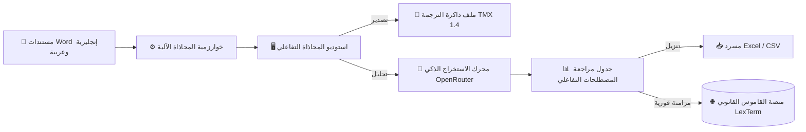

<div align="center">


# 🦉 LexTerm — Legal Terminology Workspace
### **بيئة العمل المتكاملة لمحاذاة النصوص القانونية واستخراج المصطلحات بالذكاء الاصطناعي**

[](https://streamlit.io/)
[](https://python.org)
[](https://openrouter.ai/)
[](#-استوديو-المحاذاة-alignment-studio)
[](#-حقوق-الملكية-والتطوير)

<p align="center">
  <b>منصة سحابية متقدمة للمترجمين القانونيين والباحثين اللغويين</b><br>
  تجمع بين تقنيات البرمجة الديناميكية لمحاذاة المستندات بدقة متناهية، ونماذج الذكاء الاصطناعي التوليدي لاستخلاص المصطلحات القانونية المعتمدة وتصديرها بصيغ متوافقة مع أدوات الـ CAT العالمية.
</p>

[استكشاف المميزات](#-أبرز-المميزات) •
[طريقة التثبيت](#-التثبيت-والتشغيل-السريع) •
[دليل الاستخدام](#-دليل-الاستخدام-الخطوة-بخطوة) •
[المزامنة مع القاموس](#-الربط-والمزامنة-مع-القاموس) •
[التواصل والدعم](#-حقوق-الملكية-والتطوير)

---

</div>

<br>

## 🌟 أبرز المميزات

### 📑 1. استوديو المحاذاة الذكي (Alignment Studio)
* **دعم مباشر لملفات Word (`.docx`):** قراءة متزامنة للفقرات والجداول بنفس ترتيب ورودها الأصلي دون تشويه النصوص.
* **خوارزمية محاذاة ديناميكية (Dynamic Programming):** تعتمد على التوزيع الإحصائي لطول النص الإنجليزي مقابل العربي (معامل `1.22`) وتطابق الأرقام والتواريخ.
* **محرر بصري تفاعلي متقدم:**
  * 🔀 **سحب وإفلات (Drag & Drop)** وتبديل سهمي لإعادة ترتيب ومطابقة الوحدات.
  * ✂️ **تقسيم فوري للوحدات** عند موضع المؤشر لضبط الجمل المدمجة.
  * ↩️ **تاريخ تراجع غير محدود (Undo History)** حتى 40 خطوة سابقة.
* **تصدير قياسي:** توليد ملفات ذاكرة الترجمة **TMX 1.4** المتوافقة تماماً مع Trados Studio و MemoQ و Wordfast.

### 🧠 2. محرك استخراج المصطلحات (AI Term Extractor)
* **تكامل مع أقوى النماذج اللغوية عبر OpenRouter:**
  * `Gemini 2.5 Flash` / `Gemini 3.8 Flash` (سرعة فائقة ودقة عالية).
  * `GPT-4o Mini` (تفكيك وتحليل قانوني دقيق).
  * `Llama 4 Maverick` (أداء مفتوح المصدر رائد).
* **معايير صارمة للمصطلحات القانونية:**
  * استخراج التراكيب القانونية المركبة (*Liquidated damages*, *Force majeure*, *Joint and several liability*).
  * تطبيع المصطلحات لغوياً وإزالة الزوائد وأدوات التعريف (*Normalisation*).
  * صياغة تعريف قانوني عربي رصين مبني على صيغة (*الجنس والفصل / Genus + Differentia*).
  * تصنيف المصطلح تلقائياً ضمن مجاله القانوني الدقيق (*Contract Law, Civil Liability, Property Law...*).

### 📤 3. التصدير والمزامنة الفورية
* **تصدير آمن للبيانات:** تنزيل المسرد بصيغ **Excel (`.xlsx`)** و **CSV (`UTF-8-SIG`)** مع معالجة وحماية تلقائية من ثغرات حقن الصيغ (*Formula Injection*).
* **ربط سحابي مباشر:** إرسال المصطلحات بعد اعتمادها أو تعديلها إلى خادم القاموس القانوني بضغطة زر واحدة.

---

## 🏛️ المخطط البنائي للنظام (Workflow Architecture)



---

## 🚀 التثبيت والتشغيل السريع

### 1. استنساخ المشروع
```bash
git clone https://github.com/yousefdg005/qwqw.git
cd qwqw
```

### 2. إعداد البيئة الافتراضية
```bash
# إنشاء البيئة الافتراضية
python -m venv venv

# تفعيل البيئة (Windows)
.\venv\Scripts\activate

# تفعيل البيئة (Linux / macOS)
source venv/bin/activate
```

### 3. تثبيت الحزم المطلوبة
```bash
pip install -r requirements.txt
```

### 4. تشغيل خادم التطبيق
```bash
streamlit run app.py
```
> 🌐 سيفتح التطبيق تلقائياً في متصفحك على الرابط المحلي: `http://localhost:8501`

---

## ⚙️ متغيرات البيئة (Environment Variables)

لتمكين ميزة المزامنة السحابية المباشرة مع قاعدة بيانات القاموس، قم بإنشاء أو ضبط المتغيرات التالية:

| المتغير | النوع | الوصف | القيمة الافتراضية |
| :--- | :---: | :--- | :--- |
| `INGEST_API_KEY` | `مطلوب للمزامنة` | مفتاح Bearer السري المعتمد لدى خادم القاموس | — |
| `DICTIONARY_API_URL` | `اختياري` | مسار الـ API لاستقبال المصطلحات | `https://dictionaryly.onrender.com/api/receive-terms` |

---

## 📖 دليل الاستخدام الخطوة-بخطوة

```text
[الخطوة 1] ──► الشريط الجانبي: إدخال مفتاح OpenRouter واختيار النموذج
[الخطوة 2] ──► استوديو المحاذاة: رفع الملفين والمراجعة وتوليد TMX
[الخطوة 3] ──► محرك الاستخراج: فحص الوحدات واستخراج المصطلحات
[الخطوة 4] ──► جدول النتائج: تنقيح المصطلحات وتنزيل المسرد أو مزامنته
```

1. **التهيئة:** ادخل مفتاح **OpenRouter API Key** في الشريط الجانبي واختر النموذج المناسب لسرعة ودقة التحليل.
2. **المحاذاة:** ارفع نسختي العقد أو القانون (`.docx`) بالإنجليزية والعربية؛ استخدم أدوات الاستوديو للتأكد من تطابق كل فقرة مع مقابلها، ثم حمّل ملف الـ `.tmx`.
3. **الاستخراج:** انقر فوق **بدء الاستخراج الذكي**؛ سيعمل النموذج على استخراج المصطلحات مع سياقها وتعريفاتها دون أي تكرار.
4. **التعديل والتصدير:** عدّل أي تفاصيل مباشرة في الجدول، ثم نزّل المسرد بصيغة Excel أو انقر على **إرسال التعديلات المحدثة إلى القاموس**.

---

## 📁 هيكلية ملفات المشروع

```text
📦 qwqw
 ┣ 📂 .streamlit                  # إعدادات الواجهة والمظهر
 ┣ 📂 assets                      # عناصر الهوية البصرية والشعار
 ┃ ┣ 📜 logo.jpg
 ┃ ┗ 📜 logo_icon.png
 ┣ 📜 app.py                      # جوهر التطبيق، المحاذاة ومحرك الذكاء الاصطناعي
 ┣ 📜 style.css                   # التنسيقات الفاخرة (Dark Slate & Gold)
 ┣ 📜 requirements.txt            # قائمة الاعتماديات والمكتبات
 ┗ 📜 README.md                   # وثيقة التوثيق والتشغيل
```

---

## 👨‍💻 حقوق الملكية والتطوير

تم تصميم وتطوير هذه المنصة خصيصاً لخدمة المحتوى والمصطلحات القانونية باحترافية:

* **إعداد وتطوير:** **يوسف نورالدين (Youssef Nour Eldin)**
* **📱 هاتف:** [`0928756918`](tel:0928756918)
* **✉️ بريد إلكتروني:** [`ywsfalmqmz@gmail.com`](mailto:ywsfalmqmz@gmail.com)
* **🌐 المنصة المرتبطة:** [LexTerm — Legal Dictionary](https://dictionaryly.onrender.com)

<div align="center">
  <sub>جميع الحقوق محفوظة © LexTerm Platform • بنيت بكل فخر لخدمة الترجمة والتوثيق القانوني</sub>
</div>
