<div align="center">

# 🦉 LexTerm — Legal Terminology Workspace
### *منصة المحاذاة الذكية واستخراج المصطلحات القانونية*
#### Platform A — الواجهة الأمامية للمنظومة المتكاملة

---

**المطوّر:** يوسف نورالدين المقعمز  
**الإطار الأكاديمي:** مشروع تخرج — قسم الترجمة  
**الإصدار:** 3.0

[](https://python.org)
[](https://streamlit.io)
[](https://openrouter.ai)
[](https://github.com/yousefdg005/qwqw)

</div>

---

## 📋 جدول المحتويات

1. [نظرة عامة](#1-نظرة-عامة)
2. [موقع المنصة في المنظومة الكاملة](#2-موقع-المنصة-في-المنظومة-الكاملة)
3. [المميزات الأساسية — مبدأ الإنسان في الحلقة HITL](#3-المميزات-الأساسية--مبدأ-الإنسان-في-الحلقة-hitl)
4. [تحت الغطاء — هندسة الأوامر Prompt Engineering](#4-تحت-الغطاء--هندسة-الأوامر-prompt-engineering)
5. [الدوال البرمجية المبتكرة](#5-الدوال-البرمجية-المبتكرة)
6. [البدء والتشغيل](#6-البدء-والتشغيل)
7. [سير العمل خطوة بخطوة](#7-سير-العمل-خطوة-بخطوة)
8. [التقنيات المستخدمة](#8-التقنيات-المستخدمة)
9. [صيغ التصدير](#9-صيغ-التصدير)

---

## 1. نظرة عامة

**LexTerm** هي تطبيق ويب مبني بـ **Python + Streamlit**، يعمل كالواجهة الأمامية لمنظومة متكاملة لبناء قواعد المصطلحات القانونية الثنائية (إنجليزي ↔ عربي). تُنجز هذه المنصة مرحلتين أساسيتين في سلسلة عمل المترجم:

**المرحلة 1 — استوديو المحاذاة:** استخراج النصوص من ملفات Word ومحاذاة جملها تلقائياً باستخدام خوارزمية البرمجة الديناميكية (DP)، ثم تقديمها لمراجعة المترجم التفاعلية في بيئة سحب وإفلات، وتصدير النتيجة المعتمدة كذاكرة ترجمة (TMX).

**المرحلة 2 — استخراج المصطلحات بالذكاء الاصطناعي:** معالجة كل زوج جملة معتمد عبر نموذج لغوي كبير (LLM) يعمل بأمر نظام مهندَس بدقة، لاستخراج المصطلحات القانونية وتصفيتها ومطابقتها ثنائياً، ثم دفعها إلى منصة القاموس القانوني ([Platform B](https://github.com/yousefdg005/-)) للمراجعة البشرية النهائية.

> **المبدأ التصميمي الجوهري:** الذكاء الاصطناعي يقوم بالعمل الشاق، والمترجم البشري هو المايسترو وصاحب القرار النهائي في كل مرحلة.

---

## 2. موقع المنصة في المنظومة الكاملة

```mermaid
flowchart LR
    A["📄 ملفات Word\nEN + AR .docx"] --> B

    subgraph P1["⚡ هذه المنصة — LexTerm"]
        B["استخراج النص\nوتطبيعه Unicode"] --> C
        C["تقطيع الجمل\nمع حماية الاختصارات"] --> D
        D["خوارزمية المحاذاة\nDP Aligner 1:1 / 1:2 / 2:1"] --> E
        E["🎛️ استوديو المحاذاة\nHTML5 تفاعلي"] --> F
        F["👤 اعتماد المترجم\nزر إلزامي"] --> G
        G["توليد TMX 1.4\nذاكرة الترجمة"] --> H
        H["نموذج LLM\nعبر OpenRouter API"] --> I
        I["تصفية برمجية\n_is_low_value_term()"] --> J
        J["👤 مراجعة المترجم\nجدول قابل للتعديل"] --> K
        K["إرسال دُفعي\nإلى Platform B"]
    end

    K -->|"POST /api/receive-terms\nBearer Token"| L["🏛️ القاموس القانوني\nPlatform B"]
    L --> M["👤 اعتماد الأدمن\nTBX · CSV · Excel"]

    style F fill:#EAB308,color:#000,font-weight:bold
    style J fill:#EAB308,color:#000,font-weight:bold
    style P1 fill:#0D1424,color:#EEF2F8
```



---

## 3. المميزات الأساسية — مبدأ الإنسان في الحلقة HITL

### البوابة الأولى — استوديو المحاذاة التفاعلي

بعد تشغيل خوارزمية المحاذاة التلقائية، تُعرض النتيجة في **مكوّن HTML5 مخصص** مدمج داخل Streamlit عبر `components.declare_component`. هذه ليست مجرد معاينة — إنها بيئة تحرير كاملة:

| الإمكانية | التنفيذ |
|-----------|---------|
| **سحب وإفلات** | تبديل موضع جملة إنجليزية أو عربية منفردة بشكل مستقل |
| **التقسيم** | قسّم الجملة عند موضع المؤشر إذا دمج المحاذي جملتين خطأً |
| **التحرير المباشر** | عدّل نص أي خلية مباشرةً (`contentEditable`) |
| **الحذف** | احذف أي زوج غير صالح بزر واحد |
| **التراجع** | 50 خطوة تراجع محفوظة في `historyStack` |

**التصميم الحاسم:** لا يُولَّد ملف TMX ولا تُحفظ أي بيانات إلا بعد نقر المترجم على زر **"اعتماد المحاذاة النهائية وتوليد TMX"** صراحةً. المخرج الخام للخوارزمية مجرد مسودة.

```python
# app.py — السطر 579
if st.button("🚀 اعتماد المحاذاة النهائية وتوليد TMX", use_container_width=True):
    final_pairs = [
        (p["en"].strip(), p["ar"].strip()) for p in current_pairs
        if p["en"].strip() and p["ar"].strip()   # أزواج صالحة فقط
    ]
    if final_pairs:
        st.session_state["aligned_pairs"] = final_pairs
        st.session_state["tmx_bytes"] = generate_tmx_file(final_pairs)
```

### البوابة الثانية — مراجعة جدول المصطلحات

بعد انتهاء الاستخراج بالذكاء الاصطناعي، تُعرض كل المصطلحات في **`st.data_editor`** — جدول حي قابل للتعديل الكامل. يستطيع المترجم:
- تصحيح الترجمة العربية الخاطئة مباشرةً في الخلية
- حذف مصطلحات انزلقت من فلاتر الذكاء الاصطناعي
- تعديل التعريف أو حقل التخصص
- إضافة صفوف مكتشفة يدوياً

فقط بعد المراجعة ينقر المترجم **"إرسال إلى القاموس"** لدفع البيانات إلى Platform B.

---

## 4. تحت الغطاء — هندسة الأوامر Prompt Engineering

### 4.1 تعريف الشخصية (Persona Definition)

```
You are a senior legal terminologist and termbase editor working on
English–Arabic legal texts (contracts, legislation, international law,
commercial and civil law). You produce entries of the kind found in a
professional bilingual legal termbase.
```

تحديد الدور بدقة (`termbase editor` وليس `translator`) يوجّه توزيع احتمالية الرمز (token probability distribution) نحو التفكير بـ**مداخل هيكلية** بدلاً من النثر الحر، ويُنشّط المعرفة القانونية المتخصصة في النموذج.

### 4.2 الاختبار الست-شروط — البوابة المنطقية

الأمر لا يطلب "ابحث عن مصطلحات". بل يفرض **شرطاً منطقياً مركباً** (`AND` من ستة شروط):

```
كل مرشح يجب أن يجتاز الاختبارات الست جميعاً:

1. اختبار المفهوم   — يُسمّي مفهوماً قانونياً (حق، واجب، عقوبة، مبدأ...)
2. اختبار التعريف  — يمكن تعريفه بـ جنس + فصل (X هو Y الذي...)
3. اختبار الشكل    — EN: اسم/مركب اسمي 1-6 كلمات ، AR: 1-6 كلمات، اسم أو إضافة
4. اختبار الاستقلالية — يحتفظ بمعناه القانوني خارج جملته
5. اختبار التخصص  — حصري للقانون أو له معنى قانوني مختلف عن الاستخدام العادي
6. اختبار المحاذاة — المصطلحان EN وAR كلاهما موجود فعلاً في النص المرسل
```

هذه البطارية تُرجمة مباشرة لنظرية المصطلحية الأكاديمية (Wüster, Cabré) إلى تعليمة تنفيذية.

### 4.3 القيود السلبية — الرفض التلقائي (10 فئات)

هذه أبرز تقنيات منع الهلوسة في الأمر:

```
ارفض أي مرشح:
• يحتوي فعلاً صريحاً أو مساعداً (shall, may, يجب, يلتزم...)
  → يمنع استخراج الجمل والشروط التعاقدية كمصطلحات

• صيغة قانونية نمطية (pursuant to, in accordance with, بناءً على...)
  → يمنع تلوث قاعدة البيانات بالعبارات الديباجية

• تاريخ أو رقم أو مبلغ أو مدة أو إشارة مادة
  → يمنع تسرب الأرقام والمراجع

• تسمية خاصة بالعقد ("الطرف الأول", "المقاول", "المبنى")
  → يمنع استخراج أسماء الأطراف كمصطلحات عامة

• يبدأ أو ينتهي بحرف جر أو ربط أو أداة تعريف أو ترقيم
  → يمنع تسرب الشظايا عند حدود المحاذاة

• يتجاوز 6 كلمات في أي من اللغتين
  → يمنع دخول الجمل المطوّلة
```

### 4.4 الإخراج الهيكلي المفروض (Structured Output)

الإلزام بالتنسيق يعمل على **مستويين متوازيين**:

**المستوى 1 — داخل الأمر:**
```
أعِد JSON صالحاً تماماً ولا شيء غيره: لا Markdown، لا ``` ،
لا تعليقات، لا نص قبله أو بعده.
{"terms": [{"ID": 1, "en": "...", "ar": "...",
            "definition": "...", "subject field": "..."}]}
```

**المستوى 2 — على مستوى استدعاء API:**
```python
# app.py — السطر 704
response = client.chat.completions.create(
    model=selected_model_id,
    messages=[...],
    temperature=0.0,                          # لا عشوائية — مخرج حتمي
    response_format={"type": "json_object"},  # إلزام JSON من طرف API
)
```

`temperature=0.0` ليست قيمة افتراضية بل قرار هندسي مقصود: استخراج المصطلحات يتطلب **قابلية التكرار** — نفس المدخل يجب أن ينتج نفس المخرج دائماً.

**طبقة حماية إضافية** بعد الاستجابة:
```python
# app.py — السطور 716-720
cleaned = raw_text.strip()
if cleaned.startswith("```"):             # إزالة أي Markdown تسرّب رغم التعليمات
    cleaned = re.sub(r"^```[a-zA-Z]*\s*", "", cleaned)
    cleaned = re.sub(r"\s*```$", "", cleaned).strip()
raw = json.loads(cleaned)
```

### 4.5 التحقق الصامت — Chain-of-Thought بدون إخراج

```
INTERNAL CHECK (never output it)
قبل الإجابة، اختبر كل مرشح وفق الاختبارات الست وقواعد الرفض،
احذف الفاشلين، وتأكد من وجود كل "en" و"ar" فعلاً في النصوص المرسلة.
```

هذه التقنية توجّه النموذج للتفكير التحقيقي **بصمت** قبل الإخراج، دون تلويث النتيجة بالاستدلال الوسيط.

### 4.6 منع الحشو — إذن العدم

```
لا توجد حصة. افضّل الدقة على الاستدعاء.
إذا لم يتضمن المدخل أي مصطلح صالح، أعِد {"terms": []}.
لا تحشو القائمة أبداً.
```

يُرخّص هذا للنموذج صراحةً بالإعادة بقائمة فارغة، مما يمنعه من "اختراع" مصطلحات لملء حصة متوهَّمة.

---

## 5. الدوال البرمجية المبتكرة

### 5.1 `align_segments()` — محاذاة البرمجة الديناميكية

**الموقع:** `app.py` السطور 190–218

تُنفّذ خوارزمية محاذاة ثنائية اللغة بأنماط ثلاثة: 1:1 و1:2 و2:1، مستوحاةً من المحاذيات الإحصائية الكلاسيكية (Church & Gale, 1993).

```python
def align_segments(en_segments, ar_segments):
    n, m = len(en_segments), len(ar_segments)
    dp   = [[float("inf")] * (m + 1) for _ in range(n + 1)]
    prev = [[None]          * (m + 1) for _ in range(n + 1)]
    dp[0][0] = 0.0

    for i in range(n + 1):
        for j in range(m + 1):
            if dp[i][j] == float("inf"): continue
            for a, b in ((1,1), (1,2), (2,1)):   # الأنماط الثلاثة
                le = sum(len(x) for x in en_segments[i:i+a])
                la = sum(len(x) for x in ar_segments[j:j+b])
                # دالة التكلفة: نسبة الأطوال اللوغاريتمية + عقوبة الدمج
                cost = abs(math.log((le+1)/(la+1))) * 0.10 + (a+b-2) * 0.18
                if dp[i][j] + cost < dp[i+a][j+b]:
                    dp[i+a][j+b] = dp[i][j] + cost
                    prev[i+a][j+b] = (i, j, a, b)
    # استرجاع المسار الأمثل بالتتبع العكسي
    ...
```

**دالة التكلفة:**

$$\text{cost}(a,b) = 0.10 \cdot \left|\ln\frac{l_{EN}+1}{l_{AR}+1}\right| + 0.18 \cdot (a+b-2)$$

- **حد نسبة الطول:** يستغل الملاحظة التجريبية بأن الجمل الموازية تتشارك أطوالاً متناسبة حتى بين اللغات المتباعدة بنيوياً
- **عقوبة الدمج (0.18 لكل قطعة إضافية):** تمنع المحاذي من دمج مقاطع كثيرة في زوج واحد، وهو خطأ شائع في النصوص التشريعية ذات التفصيل العربي المطوّل

**مثال تطبيقي:**
```
EN: ["The parties agree.", "Payment is due on the 1st."]
AR: ["يتفق الطرفان على البنود", "والشروط المنصوص عليها.", "يستحق السداد في الأول."]

نتيجة DP:
  زوج 1: "The parties agree." ↔ "يتفق الطرفان على البنود والشروط المنصوص عليها."  [نمط 1:2]
  زوج 2: "Payment is due on the 1st." ↔ "يستحق السداد في الأول."                   [نمط 1:1]
```

---

### 5.2 `process_docx_text_to_segments()` — تقطيع جمل مع حماية السياق

**الموقع:** `app.py` السطور 248–264

التقطيع الساذج على علامات `.!?` يفشل في النصوص القانونية بسبب الاختصارات (`Art.`, `No.`, `Sec.`...). الدالة تنفّذ استراتيجية **حماية ثم تقطيع ثم استعادة**:

```python
abbreviations = ("Mr.", "Mrs.", "Ms.", "Dr.", "Jr.", "Sr.",
                 "Inc.", "Ltd.", "No.", "e.g.", "i.e.", "Art.", "Sec.")

for paragraph in re.split(r"\n+", text):
    # المرحلة 1: استبدال نقاط الاختصار بعلامات مؤقتة
    for idx, abbr in enumerate(abbreviations):
        protected = re.sub(re.escape(abbr), f"{abbr[:-1]}<ABBR{idx}>", protected)

    # المرحلة 2: التقطيع على حدود الجمل الحقيقية فقط
    parts = re.split(r"(?<=[.!?؟؛])\s+", protected)

    # المرحلة 3: استعادة الاختصارات الأصلية
    part = re.sub(r"<ABBR(\d+)>",
                  lambda m: abbreviations[int(m.group(1))][-1], part)
```

نمط `(?<=[.!?؟؛])\s+` يستخدم **lookbehind assertion** للانقسام *بعد* علامة الجملة (بما فيها `؟` و`؛` العربيتان)، محتفظاً بالترقيم في القطعة اليسرى.

---

### 5.3 `_term_key()` — معيار التطبيع العالمي للكشف عن التكرار

**الموقع:** `app.py` السطور 185–188

```python
def _term_key(value):
    value = unicodedata.normalize("NFKC", str(value or "")).casefold()
    value = re.sub(r"[\W_]+", " ", value, flags=re.UNICODE)
    return re.sub(r"\s+", " ", value).strip()
```

| المدخل | بعد NFKC | بعد casefold | بعد إزالة الترقيم | المفتاح |
|--------|----------|-------------|-----------------|---------|
| `"Force Majeure"` | `"Force Majeure"` | `"force majeure"` | `"force majeure"` | `"force majeure"` |
| `"Force  Majeure"` | `"Force  Majeure"` | `"force  majeure"` | `"force majeure"` | `"force majeure"` |
| `"القوّة القاهرة"` | `"القوة القاهرة"` | `"القوة القاهرة"` | `"القوة القاهرة"` | `"القوة القاهرة"` |

NFKC حاسم للعربية: يُطبّع **متغيرات التشكيل** وأشكال **الهمزة** والأحرف الخاصة لـ Unicode، مما يجعل `"القوّة"` و`"القوة"` مفتاحاً واحداً.

---

### 5.4 `generate_tmx_file()` — توليد ذاكرة ترجمة متوافقة مع TMX 1.4

**الموقع:** `app.py` السطور 285–294

```python
def generate_tmx_file(pairs):
    root = ET.Element("tmx", {"version": "1.4"})
    ET.SubElement(root, "header", {
        "creationtool":        "LexTerm",
        "creationtoolversion": "3.0",
        "segtype":             "sentence",
        "adminlang":           "en-us",
        "srclang":             "en",
        "datatype":            "plaintext"
    })
    body = ET.SubElement(root, "body")
    for en, ar in pairs:
        tu  = ET.SubElement(body, "tu")
        for lang, text in (("en", en), ("ar", ar)):
            tuv = ET.SubElement(tu, "tuv",
                  {"{http://www.w3.org/XML/1998/namespace}lang": lang})
            # حذف أحرف التحكم الشائعة في ملفات PDF المُعالَجة بـ OCR
            ET.SubElement(tuv, "seg").text = _XML_BAD_RE.sub("", str(text or ""))
    return ET.tostring(root, encoding="utf-8", xml_declaration=True)
```

نقاط التنفيذ:
- يستخدم **مساحة أسماء W3C XML** للسمة `xml:lang` كما تقتضي مواصفة TMX 1.4
- يُزيل **أحرف التحكم** (`\x00–\x08`, `\x0b`, `\x0c`, `\x0e–\x1f`) الشائعة في ملفات PDF المُعالَجة بـ OCR والتي تُنتج XML مشوّهاً
- يُحدد `segtype="sentence"` لإبلاغ أدوات CAT المستقبِلة بمستوى التقسيم

---

### 5.5 `send_to_dictionary()` — جسر API متحمّل للأعطال

**الموقع:** `app.py` السطور 21–60

```python
def send_to_dictionary(extracted_terms):
    batch_size = 10          # 10 مصطلحات لكل طلب — يمنع تجاوز الحمولة وأخطاء 500
    for i in range(0, len(extracted_terms), batch_size):
        batch = extracted_terms[i:i + batch_size]
        for attempt in range(2):              # محاولتان تلقائيتان
            try:
                response = requests.post(
                    url, json={"terms": batch},
                    headers={"Authorization": f"Bearer {ingest_key}",
                             "Content-Type": "application/json"},
                    timeout=60
                )
                if response.status_code == 201:
                    batch_success = True; break
                elif attempt == 0:
                    time.sleep(2)    # انتظار إيقاظ Neon Serverless
            except Exception:
                if attempt == 0: time.sleep(2)
```

**الدُّفعات** (10 مصطلحات/طلب) تتجنب انتهاء مهلة قاعدة البيانات اللامركزية (Neon على Render). **الإعادة بعد ثانيتين** تتعامل تحديداً مع **تأخير الإيقاظ البارد** (cold-start latency) — سمة معروفة لقواعد البيانات اللامركزية التي تخمد عند الخمول.

---

### 5.6 `_is_low_value_term()` + قوائم الكلمات المتوقفة — الفلتر البرمجي بعد الذكاء الاصطناعي

**الموقع:** `app.py` السطور 182–226

```python
_EN_STOP = set("a an the and or but if then of to in on at by for from with
                without under over into upon is are was were be been being it
                this that these those as not no any all each such may shall
                will must can could should has have had do does did".split())

_AR_STOP = set("في من على إلى عن أن إن أو و ثم كما حيث هذا هذه ذلك التي
                الذي الذين اللذين كان تكون يكون يتم قد ما لا لم لن مع بين
                عند لدى كل أي بعض وفق بموجب بناء بعد قبل حيث إذا".split())

def _is_low_value_term(term):
    key = _term_key(term)
    if not key: return True
    words = key.split()
    if len(words) == 1 and (key in _EN_STOP or key in _AR_STOP): return True
    if len(words) == 1 and len(key) < 4 and not re.search(r"[\u0600-\u06ff]", key): return True
    return False
```

طبقة دفاعية إضافية تُنقّي ما أفلت من الأمر، بالتحقق من:
- الكلمات الوظيفية (حروف الجر والوصل والضمائر) في كلتا اللغتين
- الرموز القصيرة غير العربية (أقل من 4 أحرف) المحتملة أن تكون تشويشاً

---

## 6. البدء والتشغيل

### المتطلبات

| المتطلب | التفصيل |
|---------|---------|
| Python | 3.10 أو أحدث |
| مفتاح API | [OpenRouter API Key](https://openrouter.ai/keys) — مجاني بحدود |
| المتصفح | أي متصفح حديث يدعم HTML5 (Chrome, Firefox, Edge) |

### التشغيل المحلي

```bash
# 1. استنساخ المستودع
git clone https://github.com/yousefdg005/qwqw
cd qwqw

# 2. تثبيت الاعتماديات
pip install -r requirements.txt

# 3. تشغيل التطبيق
streamlit run app.py
```

سيفتح التطبيق تلقائياً على `http://localhost:8501`

### متغيرات البيئة (اختيارية)

| المتغير | الوصف | القيمة الافتراضية |
|---------|-------|----------------|
| `DICTIONARY_API_URL` | عنوان API منصة القاموس | `https://dictionaryly.onrender.com/api/receive-terms` |
| `INGEST_API_KEY` | مفتاح المصادقة مع منصة القاموس | — (مطلوب للإرسال) |

> [!NOTE]
> مفتاح OpenRouter API يُدخَل من واجهة المستخدم مباشرةً (الشريط الجانبي) ولا يُحفظ في ملفات البيئة — قرار أمني مقصود لحماية خصوصية المستخدم.

### الاستضافة على Streamlit Community Cloud

```
1. ادفع الكود إلى GitHub
2. سجّل في share.streamlit.io
3. أنشئ تطبيقاً جديداً:
   - Repository: yousefdg005/qwqw
   - Branch: main
   - Main file: app.py
4. أضف متغيرات البيئة في "Advanced settings → Secrets"
5. اضغط Deploy
```

---

## 7. سير العمل خطوة بخطوة

```
الخطوة 1 │ ارفع ملفَي Word: المصدر (إنجليزي) والهدف (عربي)
          │ → استخراج تلقائي للنص وتطبيع Unicode

الخطوة 2 │ تُقطَّع الجمل بحماية الاختصارات
          │ → تُشغَّل خوارزمية DP لمحاذاة الجمل (1:1 / 1:2 / 2:1)

الخطوة 3 │ [المترجم] يفتح استوديو المحاذاة
          │ → يراجع كل زوج ويُصحح بالسحب والتعديل والتقسيم
          │ → ينقر "اعتماد المحاذاة النهائية وتوليد TMX" ✅

الخطوة 4 │ ارفع ملف TMX في تبويب "AI Term Extractor"
          │ → اختر النموذج (Gemini / GPT-4o Mini / Llama 4)
          │ → انقر "بدء الاستخراج الذكي"

الخطوة 5 │ يُعالَج كل زوج جملة عبر نموذج LLM
          │ → الأمر يطبّق 6 شروط + 10 قواعد رفض
          │ → الإخراج: JSON هيكلي صارم

الخطوة 6 │ [المترجم] يراجع جدول المصطلحات المستخرجة
          │ → يُعدّل أو يحذف أو يُضيف
          │ → ينقر "إرسال إلى القاموس" ✅

الخطوة 7 │ المصطلحات تصل إلى Platform B بحالة "pending"
          │ → تنتظر اعتماد مدير قاعدة المصطلحات
```

---

## 8. التقنيات المستخدمة

| الطبقة | التقنية | الإصدار | الغرض |
|--------|---------|---------|-------|
| **لغة البرمجة** | Python | 3.10+ | اللغة الأساسية |
| **إطار الويب** | Streamlit | 1.x | بناء واجهة المستخدم التفاعلية |
| **المكوّن المخصص** | HTML5 + Vanilla JS | — | استوديو المحاذاة (drag & drop) |
| **تكامل الذكاء الاصطناعي** | openai SDK | — | الاستدعاء عبر OpenRouter API |
| **وسيط النماذج** | OpenRouter | — | الوصول لـ Gemini / GPT-4o / Llama 4 |
| **معالجة Word** | python-docx | — | استخراج النصوص من `.docx` |
| **معالجة البيانات** | pandas | — | إدارة جداول المصطلحات |
| **تصدير Excel** | openpyxl | — | توليد ملفات `.xlsx` |
| **تصدير XML** | xml.etree (stdlib) | — | توليد TMX 1.4 |
| **التواصل الشبكي** | requests | — | إرسال الدُّفعات إلى Platform B |

### نماذج الذكاء الاصطناعي المدعومة

| النموذج | المعرّف في OpenRouter | الميزة |
|---------|----------------------|-------|
| ⚡ Gemini 3.8 Flash | `google/gemini-3.8-flash` | سرعة + دقة متعددة اللغات |
| ⚖️ GPT-4o Mini | `openai/gpt-4o-mini` | توازن الأداء والتكلفة |
| 🦙 Llama 4 Maverick | `meta-llama/llama-4-maverick` | بديل مفتوح المصدر |

---

## 9. صيغ التصدير

| الصيغة | المعيار | يتوافق مع | يحتوي |
|--------|---------|----------|-------|
| **TMX 1.4** | TMX 1.4 | كل أدوات CAT الكبرى | أزواج الجمل المحاذاة |
| **Excel (XLSX)** | ECMA-376 | MS Excel, LibreOffice | جدول المصطلحات المستخرجة كاملاً |
| **CSV (UTF-8 BOM)** | RFC 4180 | أي معالج نصوص / Excel | المصطلحات مع BOM للعربية |

> [!TIP]
> يتضمن CSV مؤشر `\ufeff` BOM ليضمن ظهور الحروف العربية صحيحاً عند فتح الملف مباشرةً في Microsoft Excel دون الحاجة لاختيار الترميز يدوياً.

---

<div align="center">

---

**إعداد وتطوير: يوسف نورالدين المقعمز**  
📱 [0928756918](tel:0928756918) · ✉️ [ywsfalmqmz@gmail.com](mailto:ywsfalmqmz@gmail.com)

*"الذكاء الاصطناعي يعزف، والمترجم هو المايسترو."*

© 2026 — جميع الحقوق محفوظة

</div>
